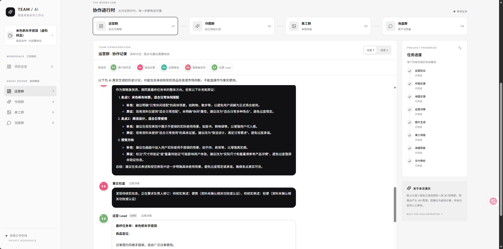
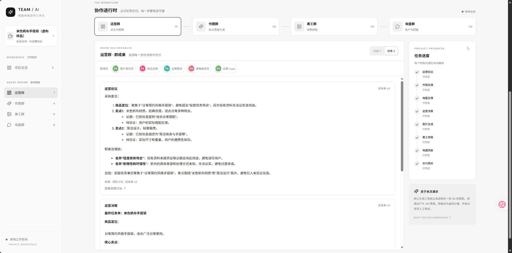
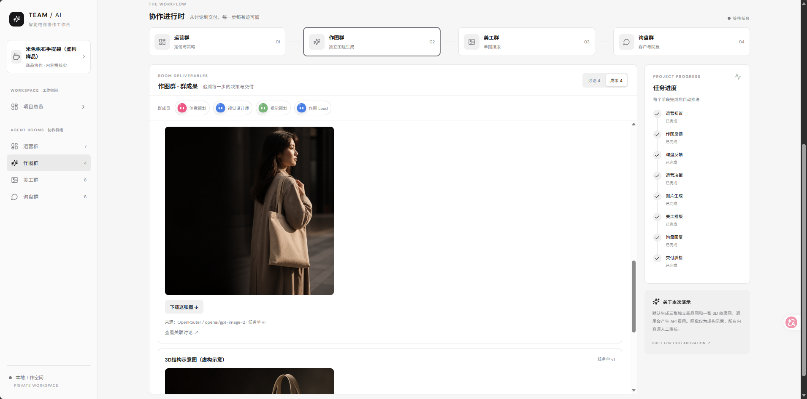
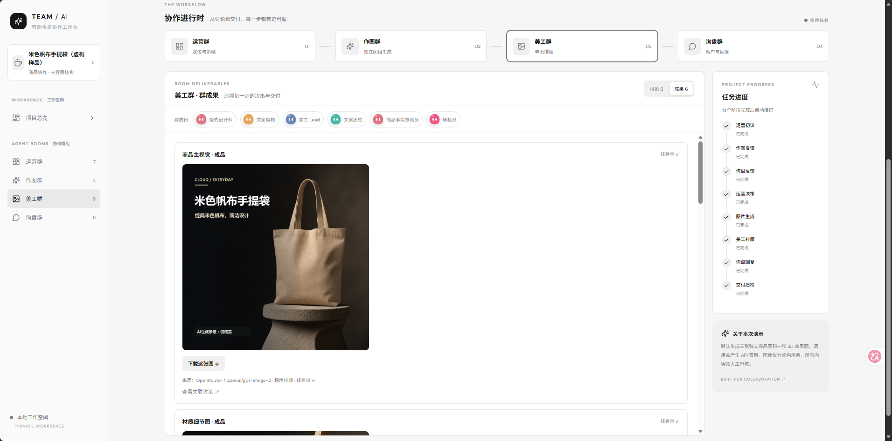
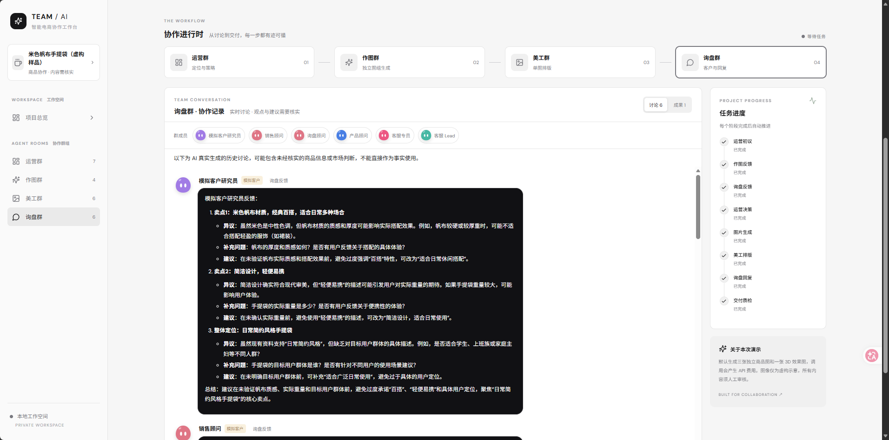

# 电商 AI 团队

一个本地运行的电商协作演示：输入商品名称和已知资料，模拟运营、作图、美工和询盘团队协作，生成商品方案、图片和客户回复，并保留讨论与任务进度。

项目参考 GrokBot 的多智能体协作展示理念，并面向电商商品任务进行设计。

> 本项目是演示原型，未连接真实店铺；客户为模拟角色。AI 生成的文字和图片可能不准确，所有成果需人工核实。

## 功能展示

截图来自虚构的帆布手提袋测试任务，商品资料仅用于演示。

| 运营群讨论 | 运营群成果 |
| --- | --- |
|  |  |

| 作图群 | 美工群 | 询盘群 |
| --- | --- | --- |
|  |  |  |

## 功能

- **自定义商品**：输入名称和已知信息，也可运行内置保温杯及帆布袋演示。
- **四个协作群**：运营群制定定位和任务单；作图群生成主视觉、细节、场景与结构概念图；美工群排版；询盘群生成模拟问答。
- **可观察的流程**：查看各角色讨论、群成果、阶段进度及任务记录；可向群里补充信息。
- **人工复核**：对部分未经确认的参数、材质和宣传表述给出提示；规则不能保证检出所有问题。

3D 结构图是虚构的二维概念图，不是可旋转或可测量的三维模型。生成图可能与实物不一致。

## 技术栈

- 前端：React、TypeScript、Vite
- 后端：Python、FastAPI、SQLite
- 模型：通过 OpenRouter 调用文本和图像模型

## 本地运行

需要 Python 3.11+、Node.js 20+、网络连接和有额度的 OpenRouter API Key。模型调用按服务商计费，一次完整任务包含多次文本请求和四次图像生成；请先检查额度和价格。

1. 在项目根目录复制配置文件并填写自己的密钥：

   ```powershell
   Copy-Item .env.example .env
   # 用编辑器填写 .env 中的 OPENROUTER_API_KEY
   ```

2. 安装并启动后端：

   ```powershell
   python -m venv .venv
   .\.venv\Scripts\Activate.ps1
   pip install -r backend/requirements.txt
   cd backend
   python -m uvicorn app.main:app --host 127.0.0.1 --port 8000
   ```

3. 另开终端，启动前端：

   ```powershell
   cd frontend
   npm install
   npm run dev
   ```

4. 打开终端显示的网址（默认 `http://127.0.0.1:5173/`）。填写商品资料并启动任务，或从任务记录中查看已有结果。

`.env` 与本地 `data/` 不应提交到仓库。修改 `.env` 后重启后端。模型、网络或额度不可用时流程可能暂停，页面会显示错误和可用的重试操作。

## 验证

```powershell
cd backend
python -m pytest -q
cd ../frontend
npm run build
```

自动测试使用模拟接口，不验证实时模型输出的质量。图像、文本、事实与权利状况均需使用者审核后再用于实际业务。

